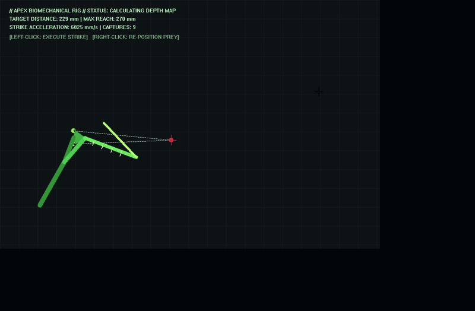

# APEX STRIKE // Bio-Kinetic Mantis Simulation

A real-time biological kinematics and predator-prey simulation written in C++. The engine models the spring-actuated raptorial strike mechanics of an Asian praying mantis (*Hierodula*) coupled with stereoscopic optical target tracking and autonomous prey evasion dynamics.



---

## Technical Overview

### 1. Analytical 2-Link Inverse Kinematics (IK)
The raptorial foreleg consists of three primary articulated links: the **Coxa** ($L_1$), **Femur** ($L_2$), and **Tibia** ($L_3$). Given a target coordinate $\vec{P}_{\text{target}} = (x_t, y_t)$ relative to the coxa-femur joint:

$$\theta_2 = -\arccos\left(\frac{\|\vec{P}\|^2 - L_2^2 - L_3^2}{2 L_2 L_3}\right)$$

$$\theta_1 = \text{atan2}(y_t, x_t) - \text{atan2}\left(L_3 \sin\theta_2, L_2 + L_3 \cos\theta_2\right)$$

The negative elbow orientation reproduces the inward folding posture characteristic of mantid predators.

### 2. Spring-Actuated Strike Dynamics
Unlike continuous muscular contraction, mantids utilize a cuticle latch mechanism that stores elastic potential energy. Upon release:
* Peak extension is achieved within $t \approx 95\text{ ms}$.
* Strike acceleration models instantaneous energy discharge before entering a damped retraction cycle.

### 3. Stereopsis & Autonomous Evasion
* **Head Articulation:** Dynamic neck swivel orienting a triangular head capsule toward the target with compound eyes and pseudopupil parallax.
* **Prey AI:** The target executes Brownian drift with air damping. When the incoming raptorial claw breaches the optical looming threshold ($R < 95\text{ mm}$), the prey activates an evasive reflex vector.

---

## System Requirements & Build

* **Compiler:** MinGW GCC / G++ (C++11 or higher)
* **OS:** Windows (Win32 GDI, double-buffered rendering)
* **Dependencies:** None (Zero external libraries)

### Compilation

```cmd
g++ main.cpp -o mantis_sim.exe -lgdi32 -luser32
